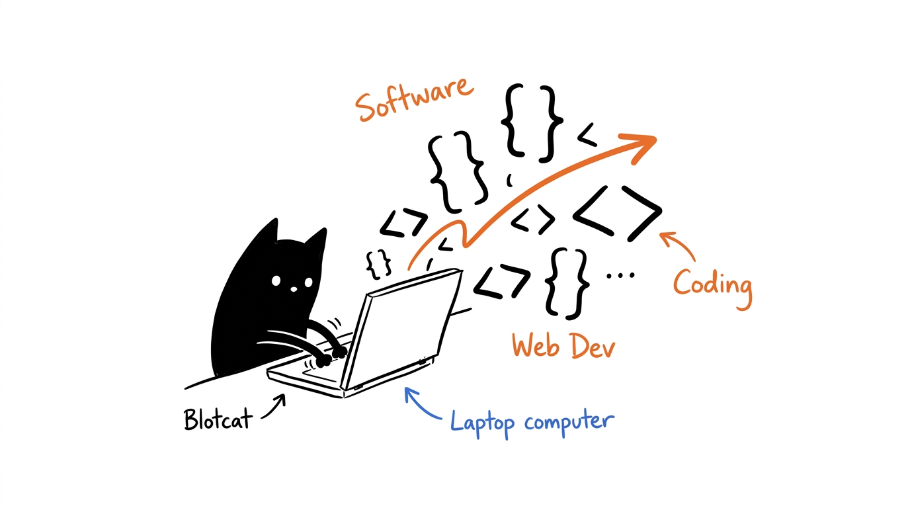

  

  <h3>Software engineer. Machine learning and backend.</h3>

  

    I work on the parts that run in production - data pipelines, training workflows,
and the services that put a model behind an API. Mostly Python, mostly on Linux.
  

  

    
    
    
    
    
    
    
    
    
    
  

   

    
  

